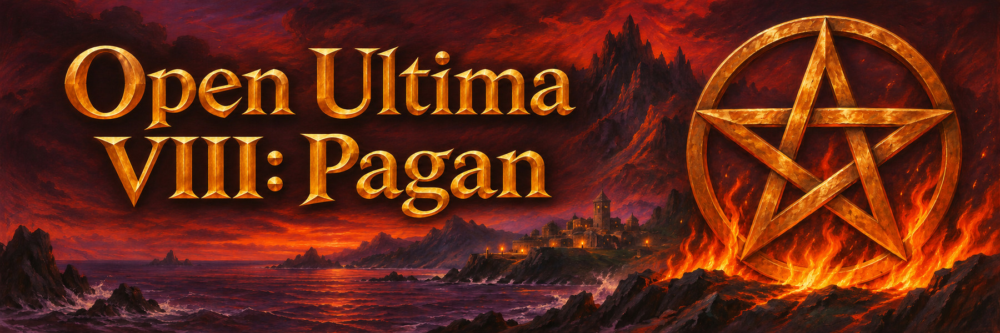
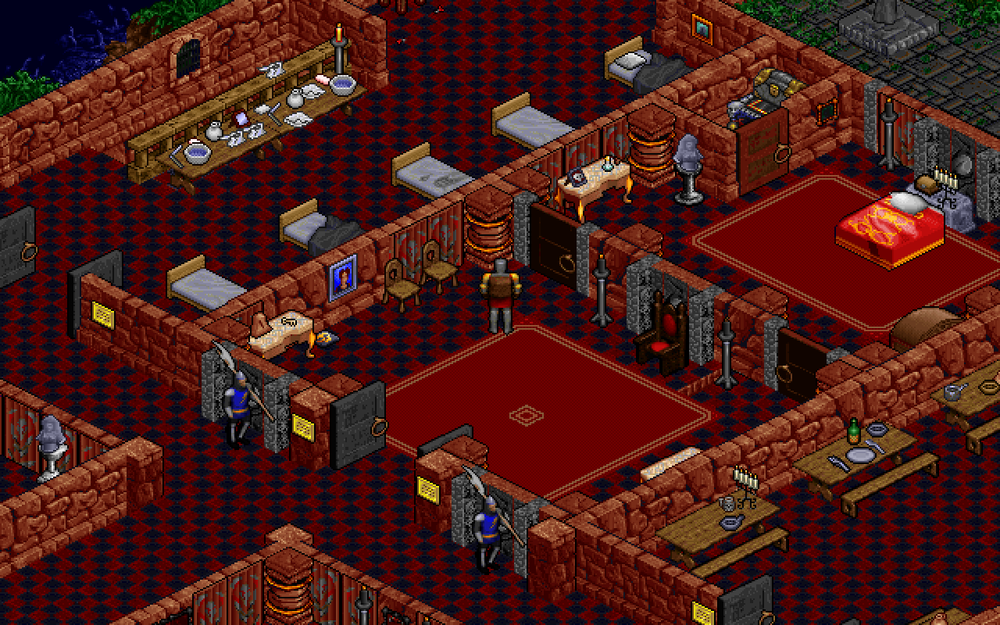
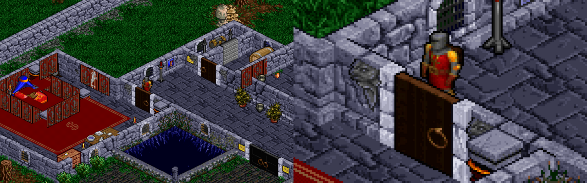
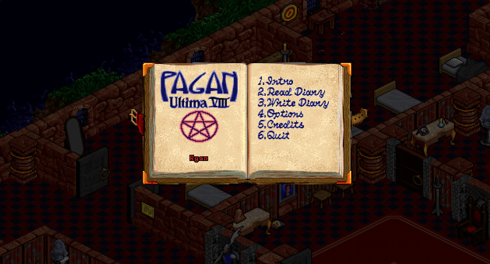
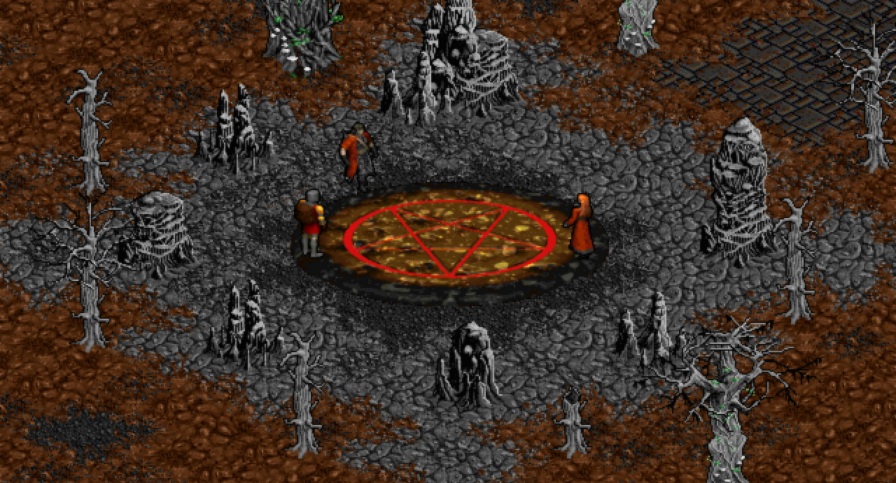
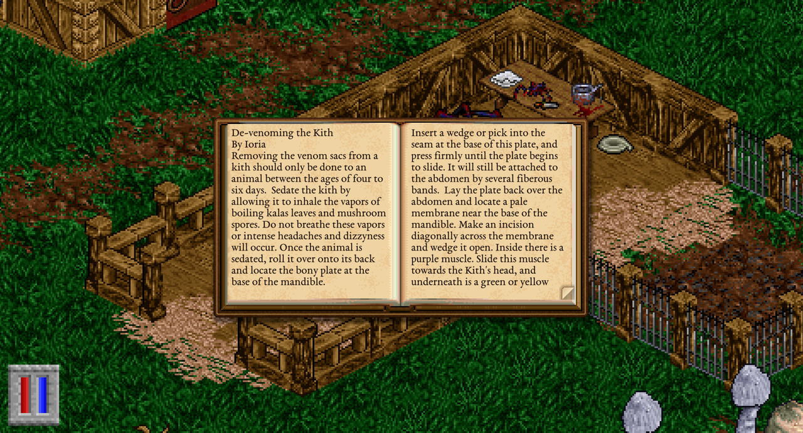
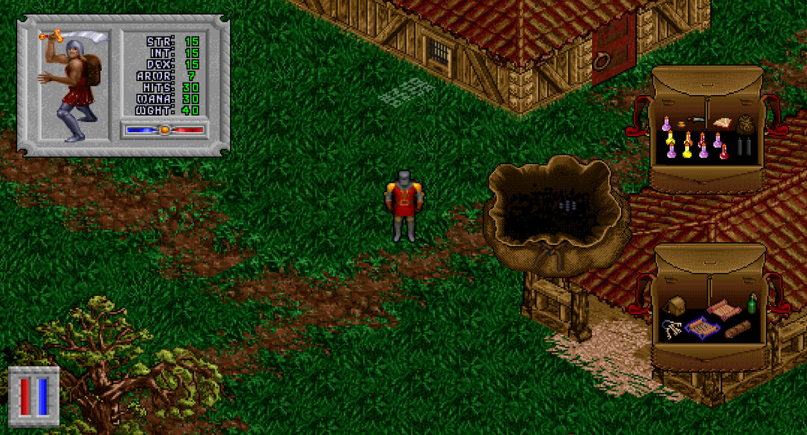

<p align="center">
  
</p>

<p align="center">
  <b>Ultima VIII: Pagan</b>, rebuilt to play on today's computers: Linux, Windows and macOS,<br>
  and handhelds like the Steam Deck and ROG Ally.<br>
  A new engine written in Rust that runs the original game's own data and scripts,<br>
  with modern upscaling, smooth zoom and a lot of small quality-of-life fixes.
</p>

<p align="center">
  <a href="../../releases/latest"><b>Download</b></a> ·
  <a href="#getting-started">Getting started</a> ·
  <a href="#controls">Controls</a> ·
  <a href="#steam-deck-and-rog-ally">Steam Deck</a> ·
  <a href="#building-from-source">Build it yourself</a> ·
  <a href="https://discord.gg/zCP5wZm5VZ">Discord</a>
</p>

<p align="center">
  
</p>

> **No game data is included.** You need your own copy of Ultima VIII (GOG or the original CD).
> Open Ultima8 replaces the game's program, not its world: everything you see and every line
> anyone speaks comes from your copy.

## Why

Pagan is a great game that's awkward to play now: DOSBox, a 320×200 picture stretched to a modern
screen, and a few rough edges the original shipped with. Open Ultima8 runs the game natively and
aims to play **exactly like the original** (same scripts, same rules, same saves) while making
it look and handle as if it were made this decade.

- **One-to-one with the original.** Your saved games load, and new saves use the original's format.
  People keep their schedules, scripts run as written and combat follows the original's rules.
- **On every desktop.** Ultima VIII was only ever released for DOS. Open Ultima8 runs it natively
  on Linux, Windows and macOS (Apple Silicon and Intel), using the data files from your own copy.
- **Sharp at any size.** Several upscalers (crisp pixels, xBRZ, xBR, CRT scanlines) and a
  smooth zoom from 1× to 8×. Windows, speech and menus keep their own size.
- **Smooth movement.** The Avatar glides instead of hopping a pixel at a time; mouse and keyboard
  both work.
- **Handhelds and controllers.** Play on the Steam Deck, the ROG Ally or with any Xbox-style pad:
  the left stick walks (lean further to run), the right stick moves the pointer, and every
  button the mouse and keyboard have is on the pad. Plug it in or out while you play.
- **Readable.** Books and scrolls in a clean book typeface at your screen's full resolution;
  speech placed over whoever's speaking, and hidden when they're on another floor.
- **Quieter.** Fireplaces, dripping water and other background sounds well below other effects, fading fast with distance, with their own "Ambience" level in the options.
- **Little extras.** Discord status (where you are, what you're doing), quick save/load,
  remembered settings, a health and mana gauge, and a picker that asks where your game is.

<table>
  <tr>
    <td colspan="2" align="center"><br><sub>Zoom from the whole neighbourhood down to the cobblestones</sub></td>
  </tr>
  <tr>
    <td width="50%" align="center"><br><sub>The original's menu, sharp at any size</sub></td>
    <td width="50%" align="center"><br><sub>The original's scenes, run by its own scripts</sub></td>
  </tr>
  <tr>
    <td width="50%" align="center"><br><sub>Books you can actually read</sub></td>
    <td width="50%" align="center"><br><sub>Upscaled sprites, with stats and containers open at once</sub></td>
  </tr>
</table>

## Getting started

1. **Download** the package for your system from [Releases](../../releases/latest) and unpack it.
2. **Point it at your game.** Any of these works:
   - copy the program into your Ultima 8 folder (the one with `STATIC`, `USECODE` and `SOUND` in it);
   - or put your game files in a folder called `U8` next to the program;
   - or just run it. If it can't find the game it asks you to pick the folder, and remembers it.
3. **Play.** It loads your current game; **Esc** opens the game's menu (new game, the
   diary to load and save, options).

Keep `U8.EXE` in the game folder: the weapon table is read out of it.

**On Linux**, run `./install-desktop.sh` in the unpacked folder to add Open Ultima8 to your app
menu (`--remove` takes it out again). **On macOS**, put the game folder (or `U8`) next to
`Open Ultima8.app`; the first time, right-click the app and choose Open (it isn't notarized).

**Music** plays through any General MIDI SoundFont (`.sf2`). It's found automatically in the usual
system places, in the game folder, or from `$U8_SOUNDFONT`. On Fedora:
`sudo dnf install fluid-soundfont-gm`. Sound effects and voices need nothing extra.

### Steam Deck and ROG Ally

> [!TIP]
> **New in 0.5: controller and touch screen support.** Play Pagan on a handheld, or with any Xbox-style pad.
> Tell us how it plays on yours, on [Discord](https://discord.gg/zCP5wZm5VZ) or in [Issues](../../issues).

**Steam Deck** (or any Linux handheld):

1. In Desktop Mode, unpack the **Linux** package next to your game.
2. In Steam, choose *Add a Non-Steam Game* and pick `u8view`.
3. In Game Mode, give it the **Gamepad** controller layout (Steam Input), so the built-in controls
   show up as an ordinary pad. The touch screen works too (see [Controls](#controls)).

**ROG Ally** (Windows): use the **Windows** package. The built-in controller is already an Xbox
pad, so there's nothing to set up.

**Back paddles** (Deck L4/L5/R4/R5, Ally M1/M2) aren't used by the game, but Steam Input or
Armoury Crate can map them to any key. The full button layout is under [Controls](#controls).

## Controls

The mouse works as in the original: the pointer is an arrow out from the Avatar, and the further
out, the faster you go.

| Mouse | Does |
|---|---|
| hold **right** | move towards the pointer (measured from the Avatar's feet). Short arrow: careful steps (slow, and won't walk off ledges), medium: walk, long: run |
| tap **right** | one careful step |
| **both buttons** | jump. Short arrow: straight up, medium: forward, long while running: a running leap. Fall short of a ledge and you catch it: towards it pulls up, away lets go |
| **left click** / **double-click** | look at / use (doors, levers, signs, people, a body to search it) |
| **left click** in combat | swing towards the pointer; hold to block |
| **double right-click** on the Avatar | draw or put away your weapon |
| **double right-click** elsewhere in combat | kick |
| **middle drag** | pan the camera (**F6** or **Home** to come back) |
| **wheel** | zoom |

| Key | Does |
|---|---|
| **arrows / WASD** | walk (hold **Shift** to run) |
| **Space** | jump |
| **C** | weapon out / away |
| **1-9** | pick a reply |
| **I / Z** | backpack / paperdoll (equipment and stats) |
| **J** | the diary: save and load |
| **Esc** | the game menu; first puts away pages and speech |
| **Backspace** | put away pages and speech |
| **Space or → / ←** | a book's next pages / the ones before (or click; the left page's turned-up corner goes back) |
| **F7 / F8** | quick save / quick load |
| **Alt-X** or **Ctrl-Q** | quit |
| **Alt-H** | swap mouse buttons (left-handed) |
| **+ / -** | zoom |
| **F1** | reply style: numbered list, or the original's red choices over the speaker |
| **F2** | look (upscaler) |
| **F3 / F4** | see inside buildings / roofs |
| **F6** | follow the Avatar / free camera |
| **F9** | stop all scripts (if a scene ever leaves you stuck) |
| **F10 / [ ]** | colour fix (if the picture looks washed out) / brightness |
| **F11** | full screen |
| **P / Shift-P** | music / sound effects on/off |
| **N / Shift-N** | next / previous song |

| Controller (Xbox names) | Does |
|---|---|
| **left stick** | walk the way it leans: a little for careful steps, halfway to walk, all the way to run |
| **D-pad** | walk like the arrow keys; in menus, move the choice; in a conversation, point at the next reply; in a book, turn pages |
| **right stick** | move the pointer (faster the further it leans) |
| **A** | the left mouse button: tap to look, double tap to use, hold to drag; in combat, swing; in menus, choose |
| **X** | use what's under the pointer |
| **RT** | the right mouse button: walk towards the pointer |
| **LT** | jump |
| **B** | put away pages and speech (back, in menus) |
| **Y / LB / RB** | backpack / paperdoll / weapon out or away |
| **Start / Back** | the game menu / the diary |
| **L3 / R3** | recentre the camera / put the pointer back on the Avatar |

| Touch screen | Does |
|---|---|
| **tap** / **double tap** | look at / use (as left click / double click; menus, books, replies and windows too) |
| **press and slide** on a thing | drag it (into a bag, onto the paperdoll, onto the floor) |
| **hold** on open ground | walk towards your finger (near: careful steps, further: walk, far: run) |
| **second finger tap** while walking | jump, the way you walk |
| **pinch** | zoom |
| **two finger tap** | the right button's tap (one careful step; on the Avatar, twice: weapon out or away) |
| **buttons on the right edge** | menu, backpack, paperdoll, combat (shown once you touch the screen; Options → Touch buttons) |

In Game Mode Steam may pass touches on as mouse clicks instead: taps still look and use there,
but holding to walk and the two finger gestures need the touches themselves.

The mouse, the pad and the touch screen share one pointer: whichever moved it last has it. Saving with a pad names
the save for you (where you are and the day); A takes it. The back paddles (Deck L4/L5/R4/R5, Ally
M1/M2) aren't used: map them in Steam Input if you like.

**In windows:** click looks, double-click uses (opens bags), drag things between windows, onto
the paperdoll to wear or wield them, or out into the world. Drag a window by its frame;
double-click the frame to close it. The button under the paperdoll's stats shows the health and
mana gauge.

**Options** (Esc → Options) has the look, the interface size, reply style, music and volume,
see-inside, full screen, mouse hand, Discord status, the original's cheats, and the controller
(on/off, pointer speed, dead zone, which stick walks). They're remembered
in `~/.config/open-ultima8/settings.cfg`.

## Saves

Saves use the original's format, in the game's own `SAVEGAME` folder, and the diary lists the
original's saves too. Anything the engine doesn't model yet is kept exactly as it was loaded.
The first time a slot made by the original is overwritten, a backup is kept as `U8SAVE.nnn.bak`.
The few things the original's format has no room for (progress towards your next stat point,
hunger, hanging from a ledge...) go in a small `U8SAVE.nnn.ou8` beside the save.

## What works

Nearly the whole game: the world and everything in it, the scripts (conversations, quests,
doors, traps, cutscenes), schedules, the inventory, equipment, combat, all four schools of magic,
monsters, jumping and climbing, music, sound and voices, the intro and ending films, the credits.

<details>
<summary><b>The full list</b></summary>

| Stage | |
|---|---|
| Flex archives, palette, shapes, typeflags | ✅ |
| Map loading (FIXED.DAT + GLOB.FLX), isometric depth sort | ✅ |
| Upscaling (F2 or Options → Look): nearest (crisp at any zoom) / smooth / xBRZ per sprite (seamless, made on the CPU) / xBR and CRT scanlines on the GPU (worked out per screen pixel, any zoom, no CPU cost). In nearest and xBRZ the world is drawn at the zoom, so walking glides by fractions of a game pixel when zoomed in | ✅ |
| Zoom: mouse wheel or +/-, 1× to 8× in steps that pass every whole size (eases smoothly; about the pointer with a free camera; big screens don't zoom out past 1920×1200 of world); crisp pixels at in-between sizes (sharp bilinear on the GPU); windows, speech and menus keep their own size (Options → Interface) | ✅ |
| Translucent effect pixels (xform palette), editor-only markers hidden | ✅ |
| wgpu viewer (scroll the world) | ✅ |
| NONFIXED items + NPCs from your save (GAMEDAT) | ✅ |
| Scenery animation (fire, waterfalls, the hourglass's script), TYPEFLAG types 1-6 as ScummVM runs them | ✅ |
| ANIM.DAT actor animations; Avatar walk/run with basic collision, stairs, cutaway | ✅ |
| Usecode VM: look, use, doors, signs/books, conversations with choices | ✅ |
| Jumping (ANIM.DAT height arcs); climbing onto ledges 16-72 high from a standing jump (strength and dexterity grow with the height) | ✅ |
| Eggs: teleporters between maps, usecode triggers, NPC/egg "fast area" events; maps keep their state | ✅ |
| Game clock (continues from your save; a game hour is 15 real minutes, as in the DOS game) + NPC schedules | ✅ |
| Saved games: load and save (original format), the diary (J), quick save/load (F7/F8); new game with its opening scene | ✅ |
| Original controls (mouse arrow: step/walk/run/jump), game menu (Esc) with options remembered between runs | ✅ |
| Game controllers (Steam Deck, ROG Ally, Xbox-style pads): sticks walk and point, buttons as the mouse and keys, menus and replies with the D-pad, plug in or out while playing; pointer speed, dead zone and which stick walks in Options | ✅ |
| Cutscene camera (scenes hold the view, glide it and centre it on whoever's talking) | ✅ |
| Each map's own music (music objects in the world pick the song) | ✅ |
| NPCs walk where scripts send them, step by step with their walk animation, routing round walls, furniture and people | ✅ |
| Inventory windows: backpack (I), paperdoll with stats (Z), bags and chests (double-click); look/use things inside; the health and mana gauge (the paperdoll's stats button) | ✅ |
| Moving things: drag between bags, out onto the floor or a table, and back; saved. Coins dropped on coins (or a reagent on the same reagent) make one pile, up to 666; dropping part of a pile asks how many with the original's slider (arrows or its buttons, drag the knob, Enter/OK; Esc or right click: never mind) | ✅ |
| The world noticing: pressure plates go down underfoot (the Avatar's, monsters', anyone's in the fast area, or under something put on them) and spring back, lava, water (deep water drowns, as in the original) and webs react to what touches them; things on top of something picked up fall; taking what isn't the Avatar's in sight of people (640 units) and guards shout "Thief!"; once carried, things are the Avatar's; people scripts send to another map are there when you arrive | ✅ |
| Equipping: drag armour or a weapon onto the paperdoll to wear or wield it, off to take it off; weight limit (4 × STR, the patched game's) | ✅ |
| Combat stance: draw the weapon (C, double right-click on the Avatar), red arrows, advance / retreat / turn, swing, kick (magic leggings kick harder), block (a fifth of STR off a blow, no stagger); the wielded weapon drawn in hand (WPNOVLAY.DAT) | ✅ |
| Hitting, as ScummVM's reading of the original has it: swings strike the person (or web, door, breakable...) in reach; damage from U8.EXE's weapon table and STR; defences, Slayer, undead-bane, fire (halves armour), 3% off per point of ARMR (worn armour + weapon bonus), a DEX roll to hit; STR and DEX grow with use; people stagger, die and stay down; scripts' hits (traps) hurt too; the Avatar can die (its tombstone, as the original's, then the game menu) | ✅ |
| People fighting back (ScummVM's reading of the original's combat): struck, they turn on the striker; scripts set targets and sides; fighters close in round furniture, turn, swing when in their weapon's reach and pause between swings by DEX; guards, monsters and townsfolk hit, defend and resist by kind (u8monsters numbers); playing dead | ✅ |
| Monster eggs: creatures hatch where the scripts say (into free NPC slots, as the original's saves have them), loiter or fight, and are put away when out of range; the dead leave loot (double-click a body to search it), skeletons rise again | ✅ |
| Seekers blow apart (pieces flung about), changelings wait in ambush as trees and spring out when you come close; the Avatar bleeds from real blows; combat music when fighting (the fanfare when an enemy falls, a lament when the Avatar dies) and the game's songs after; dropping something out of reach throws it (harder with STR, truer with DEX) | ✅ |
| Magic: Necromancy (the Key of the Necromancer makes spells from reagents in a bag), Theurgy's foci, Sorcery's charged foci, Thaumaturgy, spell scrolls, the recall item, all run by the game's own scripts; a tester's save and the original's cheat menu to try them (see Testing saves) | ✅ |
| Hanging from ledges (a jump that falls short catches the edge: towards it pulls up, away lets go); walking or jumping off an edge falls (not steered on the way down); a fall that hurts 6+ knocks the Avatar flat; it gets up shaking its head, easier to hit till then | ✅ |
| The films (STATIC/EINTRO.SKF before a new game and from the menu, ENDGAME.SKF when the game is won and from the menu): pictures, fades, music, effects, the Guardian's lines with subtitles; any key or click skips | ✅ |
| Music: MUSIC.FLX XMIDI → MT-32→GM map → SoundFont synth | ✅ |
| Sound effects (SOUND.FLX, Sonarc) placed in the world; ambient loops (fires, wind) | ✅ |
| Things fly and fall (thrown, knocked over, dropped): bouncing off walls and floors, settling on tables; people falling far are hurt; explosions burst, bang and hurt what's near, oil flasks go up together | ✅ |
| Credits and quotes (main menu) scrolling to their music, as the original lays them out; the quit question | ✅ |
| Scripts making people and things (createActor, the ethereal stack), teleporting the Avatar, asking the player to pick a target, the Guardian's voice | ✅ |
| Scripted effects: fades to and from black and white, storm tints and lightning (the palette's colour matrix, applied when presenting), earthquakes, sprite effects; the Avatar heals slowly and food heals; scripts can set the clock | ✅ |
| Spoken lines for Titans and statues (SOUND/E*.FLX) | ✅ |

</details>

<details>
<summary><b>Where it deliberately differs from the original</b></summary>

- Upscaling, zoom, smooth movement and the modern interface options.
- The smooth camera (Options): the view eases up and down with the Avatar's footing instead of
  following every jump and step, which zoomed in jolts the whole screen. Turn it off for the
  original's camera.
- Books and scrolls in a modern typeface (the page art and paging are the original's). Books
  get a leather cover round the original's open pages, and the page corners turn up where
  there are more pages; the left one turns back, which the original can't.
- Background loops (fires, water drips) at half volume. The original plays them twice as loud as
  everything else.
- Speech and sound from another floor (the hall under the roof you're on) are hidden.
- The health and mana gauge is drawn twice as big.
- The Spell of Resurrection book shows its own text (some versions of the game show the wrong book).

Everything else aims to match the original; if something plays differently, that's a bug, so
please [report it](../../issues).
</details>

<details>
<summary><b>Testing and cheats</b></summary>

**Options → Cheats** turns on the original developers' own cheat menu: click the Avatar to create
items, cast any spell, set the time, jump ahead in the story.

`u8tool U8 kit 9 from=1` writes a tester's save in slot 9 from save 1: the Avatar at its best,
carrying every school's magic and the recall item (which takes you to Tenebrae, the Plateau, the
Catacombs, the Hall of the Mountain King, Argentrock Isle, Carthax Lake or Daemon's Crag).
`at=plateau` (or any of those) starts it there.
</details>

## Discord

Come talk about the project, report bugs or share screenshots on the
[Open Ultima8 Discord](https://discord.gg/zCP5wZm5VZ).

While Discord is running, your profile shows where you are ("In Tenebrae"), what you're doing
(exploring, in combat, talking, reading...), health and mana, and how long you've played. Turn it
off in Options → Discord status. It only talks to the Discord app on your own computer.

## Building from source

You need [Rust](https://rustup.rs) (stable). On Linux, also the ALSA headers for sound and
libudev's for controllers (`sudo dnf install alsa-lib-devel systemd-devel` /
`sudo apt install libasound2-dev libudev-dev`). Without them, build with
`--no-default-features` (and `--features audio` or `--features gamepad` for the one you have).

```sh
git clone <this repo> && cd open-ultima8
cargo run --release -p u8view                  # finds your game as described above
cargo run --release -p u8view -- ~/Games/U8    # or give it the game folder
cargo run --release -p u8view -- U8 --save 2   # play saved game 2 (0 = a new game)
```

Without sound: `cargo run --release -p u8view --no-default-features`.

**Packages.** Every push to `main` builds the Linux, Windows and macOS packages on GitHub Actions
(download them from the run's page), and pushing a tag like `v0.2.0` publishes them as a release.
To make them on your own Linux machine:

```sh
./build-dist.sh        # dist/linux and dist/windows (Windows cross-compiled with MinGW)
./build-dist-osx.sh    # dist/macos: a universal Open Ultima8.app (needs zig, cargo-zigbuild, an SDK)
```

Each script says what it's missing.

**Tests.**

```sh
cargo test --workspace                                        # no game data needed
U8_DATA=/path/to/U8 cargo test --workspace -- --include-ignored  # plus tests against your copy
```

<details>
<summary><b>u8tool: inspecting the game's data</b></summary>

`u8tool` reads, exports and tests the game's files from the command line.

```sh
u8tool U8 info                          # what's in your install
u8tool U8 saves                         # saved games
u8tool U8 map 3 c c 640 480 3 map.png   # render part of a map (map 4 all 1 map4.png: the whole map)
u8tool U8 sheet 0 128 3 sheet.png       # shapes as a contact sheet
u8tool U8 anim 1 0 2 walk.png           # the Avatar's walk in 8 directions
u8tool U8 items 3 2400 2500             # what's under a screen point
u8tool U8 eggs 40                       # triggers on a map, and where teleporters lead
u8tool U8 uc list                       # scripted classes and their events
u8tool U8 uc dis 68 use                 # disassemble a door's "use" script
u8tool U8 uc run 40 s 68 use            # run it headless on the nearest door
u8tool U8 uc live 40 600 walk=3         # play headless for 600 ticks
u8tool U8 film intro 20,45 still        # stills of a film, with subtitles
u8tool U8 music tenebrae out.wav 60     # render a song (needs a SoundFont)
u8tool U8 sfx list                      # sound effects (sfx 7 out.wav exports one)
u8tool U8 speech 80 list                # recorded lines (speech 80 0 out.wav)
```
</details>

### Project layout

```
crates/u8data     the game's file formats
crates/u8engine   the game itself: world, rules, the script VM (no pixels, no window)
crates/u8render   pixels: sprites, upscalers, the isometric painter, text
crates/u8view     the game you play (winit + wgpu + cpal)
crates/u8tool     the command-line tool
```

How the pieces fit and where to add things: [ARCHITECTURE.md](ARCHITECTURE.md).

## Credits

- What's known about the game's file formats and engine comes from the **Pentagram** and
  **ScummVM** projects. Thank you!
- Book text is set in **EB Garamond** by Georg Duffner (SIL Open Font License;
  [crates/u8view/assets/OFL.txt](crates/u8view/assets/OFL.txt)).
- Ultima VIII: Pagan was made by Origin Systems. Ultima is a trademark of Electronic Arts. This
  is an unofficial fan project, not affiliated with or endorsed by Electronic Arts.

## License

[GPL-3.0-or-later](LICENSE).
